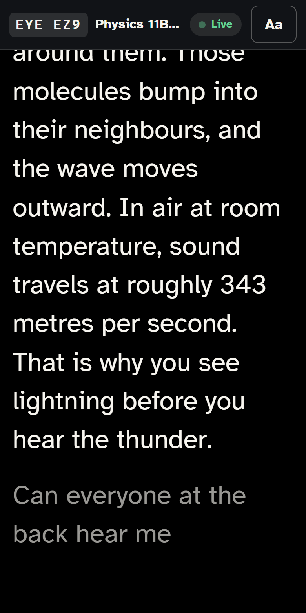
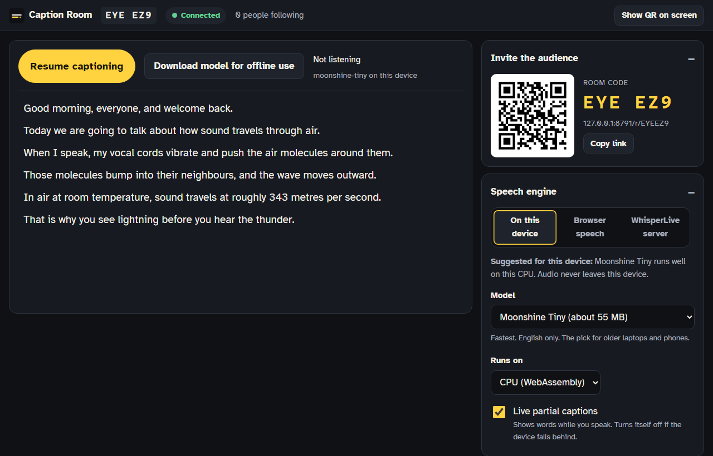
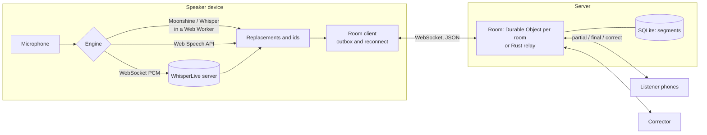

# Caption Room

[](https://github.com/mezpos/caption-room/actions/workflows/ci.yml)
[](LICENSE)

**Free, open live captions that everyone in the room can follow on their own phone.**

A speaker opens Caption Room on a laptop or phone and starts talking. Their device turns speech into text, and every listener who scans the QR code (or types a six-character room code) sees the captions live. Each listener picks their own text size and colours, and can scroll back or jump to the latest line. A helper can correct mistakes as they happen, and the speaker can download the transcript afterwards.

It runs in the cloud (one Cloudflare Durable Object per room), on your own server, or with no internet at all through a small relay on the teacher's laptop.

<p align="center">
  
  
</p>

## Why this exists

Web Captioner, a free tool built on Chrome's speech API, ran from 2017 until 31 October 2023.

- Its share link let others follow the captions on their own devices. That link ran on a Redis server.
- Its code was released under MIT at shutdown ([curtgrimes/webcaptioner](https://github.com/curtgrimes/webcaptioner)).

Nothing replaced shareable captions:

- Accessibility writer Ben Myers found no direct replacement (benmyers.dev).
- A church asking a streaming forum for a free alternative got no replies (vMix forums).
- What exists now is either commercial and billed per live minute (Subanana's QR-code audience captions), or open but incomplete. LiveCaptions is an English-only Linux desktop app with no commits in a year. [WhisperLive](https://github.com/collabora/WhisperLive) is a server library, not an audience product.

The audience is everywhere there is a room: lecture halls, places of worship, conferences. In India alone, the 2011 census found that 18.9% of the 26.8 million people with disabilities reported a hearing disability, about 5.1 million people (ORGI).

## Features

**Speaker console** (`/speak/CODE`)

- **Pluggable speech engine:**
  - On-device: **Moonshine** (fast, English) or **Whisper** (multilingual, including Hindi) run in the browser with WebGPU or multi-threaded WebAssembly. Audio never leaves the device.
  - Browser speech: Chrome, Edge or Safari's Web Speech API as a fallback, including Chrome's on-device mode with vocabulary boosting.
  - A self-hosted **WhisperLive** server for big events.
- A recommendation based on what the device can do, and a live **Performance** panel (real-time factor, caption lag, queue, round trip).
- **Download model for offline use**: fetch the speech model at home on good Wi-Fi, then caption in class without internet.
- Room code, QR, a full-screen projector view, and a share link.
- **Private rooms**: the QR code and link carry a secret, so the six-character code alone lets nobody in. Leaked links can be **replaced** at any time.
- Word replacements (applied before captions leave the device) and a vocabulary list.
- Click any line to fix it. Removing a line removes it everywhere.
- Transcript export as text, SRT, WebVTT or JSON.
- Optional **human corrector** link, plus a hand-off link to caption from another device.
- Captions spoken while the connection is down are kept and sent when it returns.

**Listener view** (`/r/CODE`)

- Large text in Atkinson Hyperlegible, five high-contrast themes, a font choice, line and letter spacing, bold and ALL CAPS.
- **Scrollback** that stops following while you read, then a **Back to live** button with a count of new lines.
- "Latest lines only" stage layout, the screen kept awake, and optional screen-reader and braille announcements.
- Download the transcript when the speaker allows it.
- An installable PWA. Reconnects after Wi-Fi drops and catches up on what it missed, corrections included.

**Corrector view** (`/fix/CODE#secret`): keyboard-friendly live editing. Fixes reach every phone instantly.

**Field-test bench** (`/bench`): measures latency and word error rate per device, engine and speaker, with Indian-English, Hinglish, Hindi and names-and-numbers passages. See [docs/risk-tests.md](docs/risk-tests.md).

**LAN mode** (`relay/`): a single binary serves the app and relays captions over the school Wi-Fi or a laptop hotspot. With the models folder it serves the speech models too, so nothing needs the internet.

## Run it

| You want to...                         | Do this                                                                                                                                                    |
| -------------------------------------- | ---------------------------------------------------------------------------------------------------------------------------------------------------------- |
| Try it on the web                      | Deploy to Cloudflare (below), or open a hosted instance if someone runs one for you                                                                        |
| Caption a classroom with weak internet | Download the relay for Windows, macOS or Linux from [Releases](https://github.com/mezpos/caption-room/releases) and see [relay/README.md](relay/README.md) |
| Host it on your own server             | `docker run -p 7300:7300 ghcr.io/mezpos/caption-room` behind HTTPS: see [docs/self-hosting.md](docs/self-hosting.md)                                       |
| Develop                                | See [Quick start](#quick-start) and [CONTRIBUTING.md](CONTRIBUTING.md)                                                                                     |

### Quick start

Requires Node 22+ (24 recommended). Rust 1.88+ is needed only for the LAN relay.

```bash
npm install
npm test                 # unit tests
npm run dev:worker       # builds the web app, runs the Worker + Durable Objects at http://127.0.0.1:8787
```

Open http://127.0.0.1:8787, create a room, and open the listener link on another tab or phone. For front-end work with hot reload, keep `dev:worker` running and also run `npm run dev` (Vite on :5173 proxies `/api` and `/ws` to the Worker).

No microphone handy? Simulate a lecture, optionally with a crowd:

```bash
node scripts/demo-speaker.mjs http://127.0.0.1:8787 --listeners 50
```

### Deploy to Cloudflare

```bash
npx wrangler login
npm run deploy           # builds apps/web and deploys apps/worker with the PWA as static assets
```

Durable Objects with SQLite storage are available on the Workers Free plan. Rooms delete themselves 24 hours after the last caption (72 hours at most). Details, custom domains and costs: [docs/deploy.md](docs/deploy.md).

If you deploy a **modified** version, set `CAPTION_ROOM_SOURCE_URL` to your repository when building, so the app's "Source code" link points at your changes (the AGPL requires this).

### LAN mode (no internet needed)

On the teacher's laptop, either download a release, or build it:

```bash
npm install && npm run build                      # build the web app (embedded into the relay)
node scripts/fetch-models.mjs                     # optional: models for fully offline use (about 400 MB)
cargo build --release --manifest-path relay/Cargo.toml
./relay/target/release/caption-room-relay --models-dir relay/models
```

- The relay prints the audience address and a QR code.
- The teacher opens `http://localhost:7300` on the laptop. Browsers only allow the microphone on localhost or HTTPS.
- Students on the same Wi-Fi scan the QR.
- The relay serves plain HTTP on the local network: fine for a classroom, use [self-hosting](docs/self-hosting.md) with HTTPS for anything on the internet.

## Speech engines

| Engine                             | Where audio goes                                                 | Languages                           | Needs                                                      | Best for                                      |
| ---------------------------------- | ---------------------------------------------------------------- | ----------------------------------- | ---------------------------------------------------------- | --------------------------------------------- |
| Moonshine Tiny or Base (on-device) | Nowhere, it stays on the device                                  | English                             | 55 to 160 MB one-time download; WebGPU or a multi-core CPU | Privacy, offline classrooms, ordinary laptops |
| Whisper Base or Small (on-device)  | Nowhere                                                          | 90+ including Hindi                 | 140 to 300 MB; a GPU helps a lot                           | Hindi and code-mixed speech, other languages  |
| Browser speech                     | The browser vendor's service, unless Chrome on-device mode is on | Many, including `en-IN` and `hi-IN` | Chrome, Edge or Safari, and internet                       | Low-end devices, quick start                  |
| WhisperLive                        | Your own server                                                  | 90+                                 | A GPU server running collabora/WhisperLive                 | Big events, best accuracy                     |

More on choosing an engine, Indian English and code-mixed speech: [docs/engines.md](docs/engines.md).

## How it fits together



- **One protocol, two servers.** The cloud Worker and the Rust relay speak the same JSON protocol ([docs/protocol.md](docs/protocol.md)). `scripts/conformance.mjs` checks both against it in CI.
- **Room logic is shared and pure.** `packages/protocol/src/room-core.ts` holds every rule: auth, private rooms, link rotation, fan-out, idempotent finals, resume and rate limits. The Durable Object only owns sockets and SQLite; the relay mirrors the same rules.
- **Resume by revision.** Every new final and every correction bumps one room counter. A phone that reconnects sends its last value and receives exactly what changed, corrections included.

A full walkthrough for contributors is in [docs/architecture.md](docs/architecture.md).

## Security and privacy

- **Who can join:** in a normal room the code is the listener key, which suits lectures, worship and conferences. **Private rooms** require the secret carried in the QR link. Speaker and corrector links carry 256-bit secrets; servers store only SHA-256 hashes, and secrets travel in the URL fragment, which never reaches servers.
- **Replacing links:** the speaker can replace the corrector link or a private room's audience link at any time; everyone using the old one is disconnected.
- **Protections:** validated messages, per-connection rate limits, join and creation limits per network, abusive sockets disconnected, per-room size caps and expiry, control and bidi characters stripped from captions, a strict Content Security Policy pinned to the exact ONNX Runtime build, and speech models pinned to exact Hugging Face commits.
- **Audio:** on-device engines never send audio anywhere. Browser speech uses the browser vendor's service unless on-device mode is on. WhisperLive sends audio to the server you choose.

Found a vulnerability? Please report it privately: see [SECURITY.md](SECURITY.md).

## Repository layout

```text
apps/web          Preact + Vite PWA: speaker, listener, corrector, bench
  src/engines     speech engines, ASR worker, VAD segmenter, resampler, WhisperLive protocol
  src/lib         room client (reconnect and outbox), caption pipeline, WER, storage, router
apps/worker       Cloudflare Worker + Room Durable Object (SQLite, hibernating WebSockets)
packages/protocol wire types, zod validation, RoomCore, client reducer, SRT/VTT/TXT export
relay             Rust LAN relay (axum), same protocol, embeds the built web app
tests/e2e         Playwright end-to-end tests (real Worker, accessibility checks)
scripts           conformance test, demo speaker and load test, offline models, license notices
docs              architecture, deploy, self-hosting, engines, protocol, risk test plan
```

## Testing

```bash
npm run lint && npm run typecheck && npm test   # Biome, TypeScript, unit tests
npm run test:coverage                           # with coverage thresholds
npm run e2e                                     # Playwright end-to-end, with axe accessibility checks
E2E_AUDIO=speech.wav npm run e2e:model          # real speech through a fake mic into on-device recognition
npm run screenshots                             # regenerate the README images in docs/images
npm run test:relay                              # Rust unit and integration tests
node scripts/conformance.mjs http://127.0.0.1:8787   # protocol conformance (Worker or relay)
```

## Known limits and roadmap

- **Latency on low-end devices and accuracy on Indian-accented and code-mixed English have not been measured yet.** [docs/risk-tests.md](docs/risk-tests.md) is the two-week plan, and `/bench` is the tool for it. Results are very welcome through the "Field test result" issue form.
- Moonshine is English-only; code-mixed rooms should use Whisper or browser speech until the accent study says otherwise.
- iOS does not allow speech recognition in home-screen web apps. Speakers on iPhone should use Safari, or an on-device model.
- The cloud build loads ONNX Runtime's 27 MB wasm from jsDelivr (it is over Cloudflare's 25 MiB per-file limit). The relay and Docker image serve their own copy.
- Ideas: translation for listeners, speaker labels, vocabulary packs per school or subject, an undo history for corrections, sign-language video alongside captions, and a Hindi interface.

## Contributing

Contributions of every kind are welcome: code, documentation, accessibility reviews, and especially field tests of real accents and real devices. Start with [CONTRIBUTING.md](CONTRIBUTING.md). Everyone taking part follows the [Code of Conduct](CODE_OF_CONDUCT.md). Changes are listed in [CHANGELOG.md](CHANGELOG.md).

## License

Caption Room is free software: you can redistribute it and/or modify it under the terms of the **GNU Affero General Public License, version 3 or later** ([LICENSE](LICENSE)). If you run a modified version for other people over a network, you must offer them its source code. Contributions are accepted under the same license with a [DCO](https://developercertificate.org/) sign-off.

Third-party components are listed in [THIRD_PARTY_NOTICES.md](THIRD_PARTY_NOTICES.md) (web app and Worker) and [relay/THIRD_PARTY_LICENSES.md](relay/THIRD_PARTY_LICENSES.md) (relay). Built on transformers.js and ONNX Runtime (Apache 2.0), Moonshine and Whisper models (MIT), Silero VAD (MIT), Preact (MIT), and the Atkinson Hyperlegible typeface by the Braille Institute (SIL OFL). The voice-activity thresholds follow the transformers.js `moonshine-web` example (Apache 2.0).

In memory of Web Captioner.
