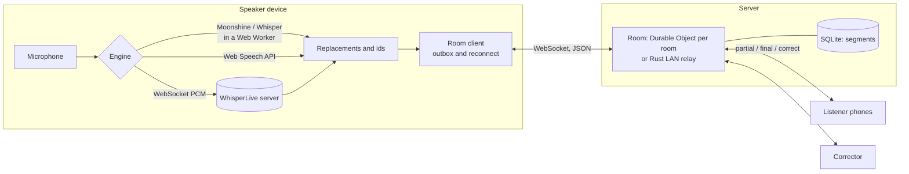

# Caption Room

**Free, open live captions that everyone in the room can follow on their own phone.**

A speaker opens Caption Room on a laptop or phone and starts talking. Their device turns speech into text, and every listener who scans the QR code (or types a six-character room code) sees the captions live. Each listener picks their own text size and colours, and can scroll back or jump to the latest line. The speaker can let a helper correct mistakes as they happen, and download the transcript afterwards.

It works in the cloud (one Cloudflare Durable Object per room). It also works with no internet at all, through a small Rust relay on the teacher's laptop.

## Why this exists

Web Captioner, a free tool built on Chrome's speech API, ran from 2017 until 31 October 2023.

- Its share link let others follow the captions on their own devices. That link ran on a Redis server.
- Its code was released under MIT at shutdown ([curtgrimes/webcaptioner](https://github.com/curtgrimes/webcaptioner)).

Nothing replaced shareable captions:

- Accessibility writer Ben Myers found no direct replacement (benmyers.dev).
- A church asking a streaming forum for a free alternative got no replies (vMix forums).
- What exists now is either commercial and billed per live minute (Subanana's QR-code audience captions), or open but incomplete. LiveCaptions is an English-only Linux desktop app with no commits in a year. [WhisperLive](https://github.com/collabora/WhisperLive) is a server library, not an audience product.

The audience is everywhere there is a room: lecture halls, places of worship, conferences. In India alone, the 2011 census found that 18.9% of the 26.8 million people with disabilities reported a hearing disability, about 5.1 million people (ORGI).

## What is in v1

**Speaker console** (`/speak/CODE`)
- **Pluggable speech engine:**
  - On-device: **Moonshine** (fast, English) or **Whisper** (multilingual, including Hindi) run in the browser with WebGPU or multi-threaded WebAssembly. Audio never leaves the device.
  - Browser speech: Chrome, Edge or Safari's Web Speech API as a fallback, including Chrome's on-device mode with vocabulary boosting.
  - A self-hosted **WhisperLive** server for big events.
- A recommendation based on what the device can do, and a live **Performance** panel. It shows the real-time factor, caption lag, queue depth and round trip.
- Room code, QR, a full-screen "show QR on the projector" view, and a share link.
- Word replacements, applied before captions leave the device, and a vocabulary list.
- Click any line to fix it. Removing a line removes it everywhere.
- Transcript export as text, SRT, WebVTT or JSON.
- Optional **human corrector** link, plus a hand-off link to caption from another device.
- Captions spoken while the connection is down are kept and sent when it returns.

**Listener view** (`/r/CODE`)
- Large text in Atkinson Hyperlegible, five high-contrast themes, a font choice, line and letter spacing, bold and ALL CAPS.
- **Scrollback** that stops following while you read, then a **Back to live** button with a count of new lines.
- "Latest lines only" stage layout, the screen kept awake, and optional screen-reader and braille announcements.
- Download the transcript when the speaker allows it.
- An installable PWA. Reconnects after Wi-Fi drops and catches up on what it missed, corrections included.

**Corrector view** (`/fix/CODE#secret`)
- Keyboard-friendly live editing. Fixes reach every phone instantly.

**Field-test bench** (`/bench`)
- Measures latency and word error rate per device, engine and speaker.
- Ships with Indian-English, Hinglish, Hindi and names-and-numbers passages.
- See [docs/risk-tests.md](docs/risk-tests.md).

**LAN mode** (`relay/`)
- A single Rust binary serves the app and relays captions over the school Wi-Fi or a laptop hotspot.
- With `scripts/fetch-models.mjs`, it serves the speech models too, so nothing needs the internet.

## How it fits together



- **One protocol, two servers.** The cloud Worker and the LAN relay speak the same JSON protocol ([docs/protocol.md](docs/protocol.md)), so the web app always talks to its own origin and does not care which one it is on. `scripts/conformance.mjs` checks both.
- **Room logic is shared and pure.** `packages/protocol/src/room-core.ts` holds every rule: auth, fan-out targets, idempotent finals, resume, rate limits. The Durable Object only owns sockets and SQLite. The Rust relay mirrors the same rules.
- **Resume by revision.** Every new final and every correction bumps one room counter (`rev`). A phone that reconnects sends its last `rev` and receives exactly what changed, including corrections it missed.
- **Hibernation.** The Durable Object uses the WebSocket Hibernation API, and keepalive pings are answered without waking it. An idle lecture costs almost nothing.

## Quick start

Requires Node 22+ (24 recommended). Rust 1.80+ is needed only for the LAN relay.

```bash
npm install
npm test                 # unit tests (protocol, room logic, audio, WER, client)
npm run dev:worker       # builds the web app, runs the Worker + Durable Object at http://127.0.0.1:8787
```

Open http://127.0.0.1:8787, create a room, and open the listener link on another tab or phone. For front-end work with hot reload, keep `dev:worker` running and also run `npm run dev` (Vite on :5173 proxies `/api` and `/ws` to the Worker).

No microphone handy? Simulate a lecture, optionally with a crowd:

```bash
node scripts/demo-speaker.mjs http://127.0.0.1:8787 --listeners 50
```

### Deploy to Cloudflare

```bash
npx wrangler login
npm run deploy           # builds apps/web and deploys apps/worker with the PWA as static assets
```

- Durable Objects with SQLite storage are available on the Workers Free plan.
- Rooms delete themselves 24 hours after the last caption.
- Room creation is rate-limited per client IP (`ratelimits` in `apps/worker/wrangler.jsonc`).

### LAN mode (no internet needed)

On the teacher's laptop:

```bash
npm install && npm run build                      # build the web app (embedded into the relay)
node scripts/fetch-models.mjs                     # optional: download models for offline use (about 400 MB)
cargo build --release --manifest-path relay/Cargo.toml
./relay/target/release/caption-room-relay --models-dir relay/models
```

- The relay prints the audience address and a QR code.
- The teacher opens `http://localhost:7300` on the laptop. Browsers only allow the microphone on localhost or HTTPS.
- Students on the same Wi-Fi scan the QR.
- See [relay/README.md](relay/README.md) for flags and firewall notes.

## Speech engines

| Engine | Where audio goes | Languages | Needs | Best for |
| --- | --- | --- | --- | --- |
| Moonshine Tiny or Base (on-device) | Nowhere, it stays on the device | English | 55 to 160 MB one-time download; WebGPU or a multi-core CPU | Privacy, offline classrooms, ordinary laptops |
| Whisper Base or Small (on-device) | Nowhere | 90+ including Hindi | 140 to 300 MB; a GPU helps a lot | Hindi and code-mixed speech, other languages |
| Browser speech | The browser vendor's service, unless Chrome on-device mode is on | Many, including `en-IN` and `hi-IN` | Chrome, Edge or Safari, and internet | Low-end devices, quick start |
| WhisperLive | Your own server | 90+ | A GPU server running collabora/WhisperLive | Big events, best accuracy |

Notes:

- WhisperLive closes connections after `max_connection_time` (300 s by default). Caption Room reconnects without losing words.
- Use `wss://` when the app is served over HTTPS.

## Repository layout

```text
apps/web          Preact + Vite PWA: speaker, listener, corrector, bench
  src/engines     speech engines, ASR worker, VAD segmenter, resampler, WhisperLive protocol
  src/lib         room client (reconnect and outbox), caption pipeline, WER, storage, router
apps/worker       Cloudflare Worker + Room Durable Object (SQLite, hibernating WebSockets)
packages/protocol wire types, zod validation, RoomCore, client reducer, SRT/VTT/TXT export
relay             Rust LAN relay (axum), same protocol, embeds the built web app
scripts           conformance test, demo speaker / load test, offline model fetcher
docs              protocol spec, two-week risk test plan
```

## Testing

```bash
npm test                                   # TypeScript unit tests
npm run test:coverage                      # with coverage thresholds
npm run typecheck
npm run test:relay                         # Rust unit and integration tests
node scripts/conformance.mjs http://127.0.0.1:8787   # protocol conformance (Worker)
node scripts/conformance.mjs http://127.0.0.1:7300   # protocol conformance (LAN relay)
```

## Security model

**Who can do what**

- **The room code is the listener key.** Anyone with the code (or QR) can read the captions, which is the point for lectures, worship and conferences. Do not caption confidential meetings with v1.
- **The speaker and corrector links carry 256-bit secrets.**
  - The secret travels in the URL fragment, which is never sent to servers, and is removed from the address bar on arrival.
  - Servers store only SHA-256 hashes of the secrets.

**Protections in place**

- Every message is validated with zod.
- Each connection is rate limited (token buckets), and history requests cost extra.
- Abusive sockets are disconnected.
- Room creation and joins are rate limited per client network. IPv6 is keyed by /64; IPv4 limits stay generous because schools share one address.
- Guessing a code that does not exist creates no storage.
- Each room has a size cap, expires 24 hours after its last activity, and lives at most 72 hours.
- Caption text is stripped of control and bidi characters, so exported SRT/VTT files cannot be injected with extra cues.
- The CSP allows scripts only from this origin and the exact ONNX Runtime build on jsDelivr.
- Model downloads are pinned to Hugging Face commits.

**Not yet in v1:** private rooms (a listener secret in the QR), rotating a leaked corrector link, and an undo history for corrections.

## Known limits and next steps

- **Latency on low-end devices and accuracy on Indian-accented and code-mixed English have not been measured yet.** [docs/risk-tests.md](docs/risk-tests.md) is the two-week plan, and `/bench` is the tool for it.
- Moonshine is English-only; code-mixed rooms should use Whisper or browser speech until the accent study says otherwise.
- iOS does not allow speech recognition in home-screen web apps. Speakers on iPhone should use Safari, or an on-device model.
- The cloud build loads ONNX Runtime's 27 MB wasm from jsDelivr: it is over Cloudflare's 25 MiB per-file limit. The LAN relay serves its own copy.
- Ideas for v2:
  - private rooms and link rotation;
  - translation for listeners;
  - speaker labels;
  - a vocabulary pack per school or subject;
  - sign-language video alongside captions.

## License and credits

MIT. Built on:

- transformers.js and ONNX Runtime Web (Apache 2.0)
- Moonshine (MIT) and Whisper (MIT) models
- Silero VAD (MIT)
- Preact (MIT)
- Cloudflare Workers and Durable Objects
- the Atkinson Hyperlegible typeface by the Braille Institute (SIL OFL)

The voice-activity thresholds follow the transformers.js `moonshine-web` example (Apache 2.0).

In memory of Web Captioner.
