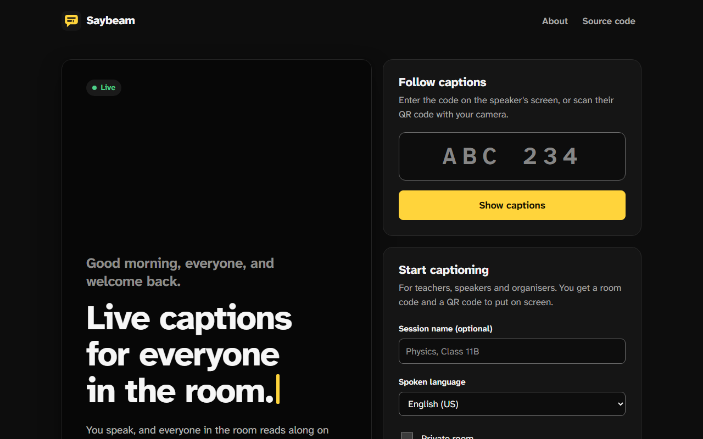
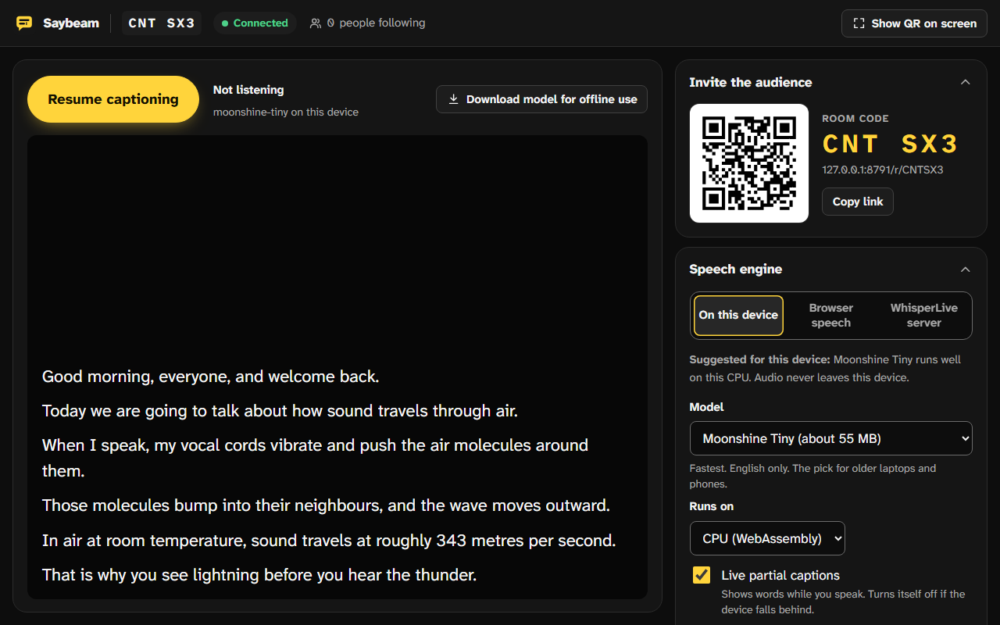
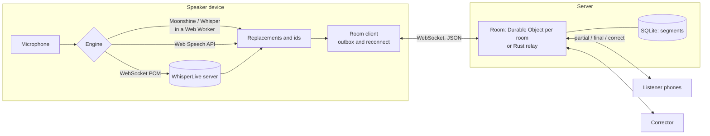

<div align="center">


# Saybeam

**Live captions for everyone in the room.**

You speak. Everyone in the room reads along on their own phone, at their own text size and colours.<br>
No app, no account. Free and open source.

[](https://github.com/byjoellobo/saybeam/actions/workflows/ci.yml)
[](https://github.com/byjoellobo/saybeam/releases)
[](LICENSE)

[User guide](docs/user-guide.md) · [Self-hosting](docs/self-hosting.md) · [LAN relay](relay/README.md) · [All docs](docs/README.md) · [Changelog](CHANGELOG.md)

</div>

<picture>
  <source media="(prefers-color-scheme: dark)" srcset="docs/images/home-dark.png">
  <source media="(prefers-color-scheme: light)" srcset="docs/images/home-light.png">
  
</picture>

## What it does

A speaker opens Saybeam on a laptop or phone and starts talking. The device turns speech into text, and everyone who scans the QR code (or types a six-character room code) sees the captions live:

- **Readers choose the look:** each listener picks their own text size, contrast theme and spacing.
- **Scroll back, then return:** listeners can reread earlier lines, then press **Back to live**.
- **Live fixes:** a helper can correct mistakes as they happen.
- **Transcripts:** the speaker downloads the transcript afterwards.

It runs in the cloud (one Cloudflare Durable Object per room), on your own server, or with **no internet at all** through a small relay on the teacher's laptop.

<p align="center">
  
  &nbsp;
  <picture>
    <source media="(prefers-color-scheme: dark)" srcset="docs/images/speaker-dark.png">
    <source media="(prefers-color-scheme: light)" srcset="docs/images/speaker-light.png">
    
  </picture>
</p>

## Why it exists

Web Captioner, a free tool built on Chrome's speech API, ran from 2017 until 31 October 2023. Its share link let anyone follow the captions on their own device. When it closed, its code was released under the MIT license ([curtgrimes/webcaptioner](https://github.com/curtgrimes/webcaptioner)), but nothing took the place of shareable captions:

- **No direct replacement:** accessibility writer Ben Myers found none.
- **No free alternative:** a church asking a streaming forum for one got no replies.
- **What exists now:**
  - commercial and billed per live minute; or
  - open but incomplete: [LiveCaptions](https://github.com/abb128/LiveCaptions) is a desktop app, and [WhisperLive](https://github.com/collabora/WhisperLive) is a server library, not an audience product.

The audience is everywhere there is a room: lecture halls, places of worship, conferences. In India alone, the 2011 census counted about 5.1 million people who reported a hearing disability.

## Highlights

| For                                 | What you get                                                                                                                                                                                                                                                                                                                                                 |
| ----------------------------------- | ------------------------------------------------------------------------------------------------------------------------------------------------------------------------------------------------------------------------------------------------------------------------------------------------------------------------------------------------------------ |
| **Speakers** (`/speak/CODE`)        | <ul><li>Speech engines on the device itself (Moonshine, Whisper), the browser's speech service, or your own WhisperLive server</li><li>A room code, a QR code and a full-screen projector view</li><li>Word replacements and vocabulary</li><li>Click any line to fix it</li><li>Export as TXT, SRT, WebVTT or JSON</li><li>Offline model download</li></ul> |
| **Listeners** (`/r/CODE`)           | <ul><li>Atkinson Hyperlegible type, five high-contrast themes, size up to 140 px</li><li>Scrollback with **Back to live**</li><li>A "latest lines only" stage layout</li><li>Screen reader and braille announcements</li><li>An installable PWA that catches up after Wi-Fi drops</li></ul>                                                                  |
| **Correctors** (`/fix/CODE#secret`) | Keyboard-friendly live editing. Fixes reach every phone instantly.                                                                                                                                                                                                                                                                                           |
| **Private rooms**                   | The QR code and link carry a secret, so the room code alone lets nobody in. Leaked links can be replaced at any time.                                                                                                                                                                                                                                        |
| **Schools with weak internet**      | LAN mode: one binary on the teacher's laptop serves the app, relays captions and can serve the speech models too.                                                                                                                                                                                                                                            |
| **Field testers** (`/bench`)        | Measures latency and word error rate per device, engine and speaker, with Indian English, Hinglish, Hindi and names-and-numbers passages.                                                                                                                                                                                                                    |

## Get started

| You want to...                         | Do this                                                                                                                                                        |
| -------------------------------------- | -------------------------------------------------------------------------------------------------------------------------------------------------------------- |
| Use it in a session                    | Read the [user guide](docs/user-guide.md) for speakers, listeners and correctors                                                                               |
| Run it on the web                      | [Deploy to Cloudflare](#deploy-to-cloudflare) (the free Workers plan is enough to start)                                                                       |
| Caption a classroom with weak internet | Download the relay for Windows, macOS or Linux from [Releases](https://github.com/byjoellobo/saybeam/releases), then follow [relay/README.md](relay/README.md) |
| Host it on your own server             | `docker run -p 7300:7300 ghcr.io/byjoellobo/saybeam` behind HTTPS: see [docs/self-hosting.md](docs/self-hosting.md)                                            |
| Work on the code                       | [Quick start](#quick-start) below, then [CONTRIBUTING.md](CONTRIBUTING.md)                                                                                     |

### Quick start

Requires Node 22 or later (24 recommended). Rust 1.88 or later is needed only for the LAN relay.

```bash
npm install
npm test                 # unit tests
npm run dev:worker       # builds the web app, runs the Worker and Durable Objects at http://127.0.0.1:8787
```

Open http://127.0.0.1:8787, create a room, and open the listener link in another tab or on a phone. For front-end work with hot reload, keep `dev:worker` running and also run `npm run dev`. Vite on port 5173 proxies `/api` and `/ws` to the Worker.

No microphone handy? Simulate a lecture, optionally with a crowd of listeners:

```bash
node scripts/demo-speaker.mjs http://127.0.0.1:8787 --listeners 50
```

### Deploy to Cloudflare

```bash
npx wrangler login
npm run deploy           # builds apps/web and deploys apps/worker with the PWA as static assets
```

Durable Objects with SQLite storage are available on the Workers Free plan. Rooms delete themselves 24 hours after the last caption, and live at most 72 hours. Custom domains, costs and limits: [docs/deploy.md](docs/deploy.md). To deploy from GitHub Actions on every release instead, see [docs/ci-cd.md](docs/ci-cd.md).

If you deploy a **modified** version, set `SAYBEAM_SOURCE_URL` to your repository when building, so the app's "Source code" link points at your changes. The AGPL requires this.

### LAN mode (no internet needed)

On the teacher's laptop, download a release, or build it yourself:

```bash
npm install && npm run build                      # the web app, embedded into the relay
node scripts/fetch-models.mjs                     # optional: speech models for fully offline use (about 400 MB)
cargo build --release --manifest-path relay/Cargo.toml
./relay/target/release/saybeam-relay --models-dir relay/models
```

1. The relay prints the audience address and a QR code.
2. The teacher opens `http://localhost:7300` on the laptop. Browsers allow the microphone only on localhost or HTTPS.
3. Students on the same Wi-Fi scan the QR code.

The relay serves plain HTTP on the local network. That is fine for a classroom. For anything on the internet, use [self-hosting](docs/self-hosting.md) with HTTPS.

## Speech engines

| Engine                             | Where audio goes                                                 | Languages                           | Needs                                                      | Best for                                      |
| ---------------------------------- | ---------------------------------------------------------------- | ----------------------------------- | ---------------------------------------------------------- | --------------------------------------------- |
| Moonshine Tiny or Base (on-device) | Nowhere: it stays on the device                                  | English                             | 55 to 160 MB one-time download; WebGPU or a multi-core CPU | Privacy, offline classrooms, ordinary laptops |
| Whisper Base or Small (on-device)  | Nowhere                                                          | 90+ including Hindi                 | 140 to 300 MB; a GPU helps a lot                           | Hindi and code-mixed speech, other languages  |
| Browser speech                     | The browser vendor's service, unless Chrome on-device mode is on | Many, including `en-IN` and `hi-IN` | Chrome, Edge or Safari, and internet                       | Low-end devices, a quick start                |
| WhisperLive                        | Your own server                                                  | 90+                                 | A GPU server running collabora/WhisperLive                 | Big events, best accuracy                     |

How to choose, with notes on Indian English and code-mixed speech: [docs/engines.md](docs/engines.md).

## How it fits together



- **One protocol, two servers.** The cloud Worker and the Rust relay speak the same JSON protocol ([docs/protocol.md](docs/protocol.md)). `scripts/conformance.mjs` checks both in CI.
- **Room logic is shared and pure.** `packages/protocol/src/room-core.ts` holds every rule:
  - auth, private rooms and link rotation;
  - fan-out and idempotent finals;
  - resume and rate limits.

  The Durable Object only owns sockets and SQLite, and the relay mirrors the same rules.
- **Resume by revision.** Every final and every correction bumps one room counter. A phone that reconnects sends its last value and receives exactly what changed, corrections included.

The contributor walkthrough is in [docs/architecture.md](docs/architecture.md). The design system (colour tokens, type, components, the caption cursor) is in [apps/web/DESIGN.md](apps/web/DESIGN.md).

## Security and privacy

- **Who can join:**
  - In a normal room, the code is the listener key, which suits lectures, worship and conferences.
  - Private rooms also require the secret carried in the QR link.
  - Speaker and corrector links carry 256-bit secrets. Secrets travel in the URL fragment, which never reaches servers, and servers store only SHA-256 hashes.
- **Replacing links:** the speaker can replace the corrector link, or a private room's audience link, at any time. Everyone using the old one is disconnected.
- **Protections:**
  - every message is validated;
  - rate limits apply per connection, and per network for joins and room creation;
  - abusive sockets are disconnected;
  - rooms have size caps and expire;
  - control and bidi characters are stripped from captions;
  - a strict Content Security Policy is pinned to the exact ONNX Runtime build;
  - speech models are pinned to exact Hugging Face commits.
- **Audio:**
  - on-device engines never send audio anywhere;
  - browser speech uses the browser vendor's service, unless on-device mode is on;
  - WhisperLive sends audio to the server you choose.
- **Supply chain:**
  - CI actions are pinned to commit SHAs;
  - releases ship `SHA256SUMS` and build provenance attestations;
  - CodeQL and dependency review run on every pull request.

Found a vulnerability? Please report it privately, as described in [SECURITY.md](SECURITY.md).

## Project status

Saybeam is at **0.2**: feature-complete for its first scope and tested end to end, but not yet proven in the field.

- **Not measured yet:** latency on low-end devices, and accuracy on Indian-accented and code-mixed English. [docs/risk-tests.md](docs/risk-tests.md) is the two-week plan and `/bench` is the tool. Results are very welcome through the "Field test result" issue form.
- **Moonshine is English-only.** Code-mixed rooms should use Whisper or browser speech until the accent study says otherwise.
- **iPhone speakers:** iOS does not allow speech recognition in home-screen web apps, so speakers on an iPhone should use Safari, or an on-device model.
- **ONNX Runtime from jsDelivr:** the cloud build loads ONNX Runtime's 27 MB wasm from jsDelivr, because it is over Cloudflare's 25 MiB per-file limit. The relay and the Docker image serve their own copy.
- **Ideas:**
  - translation for listeners and speaker labels;
  - vocabulary packs per school or subject;
  - an undo history for corrections;
  - sign-language video alongside captions;
  - a Hindi interface.

Versions follow [Semantic Versioning](https://semver.org/); while in 0.x, a minor release may change behaviour. How releases are cut: [docs/releasing.md](docs/releasing.md).

## Development

```bash
npm run lint && npm run typecheck && npm test        # Biome, TypeScript, unit tests
npm run test:coverage                                # with coverage thresholds
npm run e2e                                          # Playwright end to end, with axe checks in light and dark
E2E_AUDIO=speech.wav npm run e2e:model               # real speech through a fake mic into on-device recognition
npm run screenshots                                  # regenerate the README images in docs/images
npm run test:relay                                   # Rust unit and integration tests
node scripts/conformance.mjs http://127.0.0.1:8787   # protocol conformance (Worker or relay)
npm run version:check                                # every package, the crate and the changelog agree
```

```text
apps/web          Preact + Vite PWA: speaker, listener, corrector, bench
  src/engines     speech engines, ASR worker, VAD segmenter, resampler, WhisperLive protocol
  src/lib         room client (reconnect and outbox), caption pipeline, WER, storage, router
apps/worker       Cloudflare Worker + Room Durable Object (SQLite, hibernating WebSockets)
packages/protocol wire types, zod validation, RoomCore, client reducer, SRT/VTT/TXT export
relay             Rust LAN relay (axum): same protocol, embeds the built web app
tests/e2e         Playwright end-to-end tests (real Worker, accessibility checks)
scripts           release tooling, conformance test, demo speaker and load test, offline models, notices
docs              user guide, architecture, deploy, self-hosting, engines, protocol, CI/CD, releasing
```

CI runs on every push and pull request:

- lint, types and unit tests with coverage;
- the web build;
- the relay's tests;
- protocol conformance against both servers;
- the end-to-end suite.

Pushing a version tag builds the relay for Windows, Linux and macOS, publishes the Docker image and the GitHub release, and deploys to Cloudflare when credentials are configured. Details: [docs/ci-cd.md](docs/ci-cd.md).

## Contributing

Contributions of every kind are welcome: code, documentation, accessibility reviews, translations, and especially field tests of real accents on real devices. Start with [CONTRIBUTING.md](CONTRIBUTING.md). Everyone taking part follows the [Code of Conduct](CODE_OF_CONDUCT.md).

## License

Saybeam is free software: you can redistribute it and/or modify it under the terms of the **GNU Affero General Public License, version 3 or later** ([LICENSE](LICENSE)). If you run a modified version for other people over a network, you must offer them its source code. Contributions are accepted under the same license with a [Developer Certificate of Origin](https://developercertificate.org/) sign-off.

Third-party components are listed in [THIRD_PARTY_NOTICES.md](THIRD_PARTY_NOTICES.md) (web app and Worker) and [relay/THIRD_PARTY_LICENSES.md](relay/THIRD_PARTY_LICENSES.md) (relay). Saybeam is built on:

- transformers.js and ONNX Runtime (Apache 2.0);
- the Moonshine and Whisper models (MIT);
- Silero VAD (MIT);
- Preact (MIT);
- the Atkinson Hyperlegible Next and Mono typefaces by the Braille Institute (SIL OFL).

The voice-activity thresholds follow the transformers.js `moonshine-web` example (Apache 2.0).

In memory of Web Captioner.
