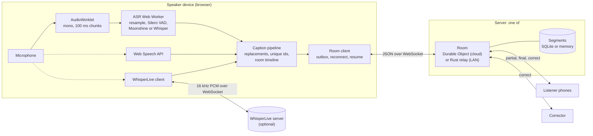

# Architecture

This page is for new contributors. It explains the moving parts of Caption Room, how a spoken word becomes a caption on a phone, and where to start reading the code. The wire protocol itself is specified in [protocol.md](protocol.md).

## Components

| Component       | Where               | What it does                                                                                                                                                                                                          |
| --------------- | ------------------- | --------------------------------------------------------------------------------------------------------------------------------------------------------------------------------------------------------------------- |
| Web app         | `apps/web`          | One Preact PWA with every screen: home, speaker console (`/speak/CODE`), listener view (`/r/CODE`), corrector view (`/fix/CODE`), field-test bench (`/bench`). Speech recognition runs here, on the speaker's device. |
| Shared protocol | `packages/protocol` | Wire types, zod validation, the room rules (`RoomCore`), the client-side reducer, and transcript export (TXT, SRT, WebVTT, JSON).                                                                                     |
| Cloud server    | `apps/worker`       | A Cloudflare Worker for the small HTTP API, plus one `Room` Durable Object per room that owns its WebSockets and SQLite storage.                                                                                      |
| LAN relay       | `relay`             | A single Rust binary (axum) that speaks the same protocol, keeps rooms in memory, and serves the web app from inside the binary. For classrooms with weak or no internet.                                             |
| Scripts         | `scripts`           | `conformance.mjs` (protocol checks against either server), `demo-speaker.mjs` (simulated speaker and listener crowd), `fetch-models.mjs` (download models for offline LAN use).                                       |

The web app always talks to its own origin (`/api/...` and `/ws/...`), so it never needs to know whether it was served by the Worker or the relay. `GET /api/info` tells it which one it is on (`mode: 'cloud' | 'lan'`) and whether speech models are served locally.

Only caption text leaves the speaker's device, unless the speaker picks the browser's speech service (audio goes to the browser vendor) or a WhisperLive server (audio goes to that server).

## The speech pipeline

All three engines implement the same small interface (`CaptionEngine` in `apps/web/src/engines/types.ts`): they report partial captions (words still changing), final captions (settled text with start and end times), status and performance stats.

### On-device engine (Moonshine and Whisper)

`local-engine.ts` runs the main-thread side; `asr.worker.ts` does the heavy work in a Web Worker.

1. **Capture.** `audio-capture.ts` opens the microphone with echo cancellation, noise suppression and auto gain on. A tiny AudioWorklet (`public/audio/capture-worklet.js`) downmixes to mono and posts chunks of about 100 ms at the device's native sample rate. Chunks are transferred to the worker without copying.
2. **Resample.** `resample.ts` converts to 16 kHz, the rate speech models expect. Downsampling averages the input samples under each output sample (a cheap box filter that is enough for speech); upsampling, rare except for 8 kHz Bluetooth headsets, interpolates linearly. State carries across chunks so there are no clicks at chunk edges. A `FrameChunker` then cuts the stream into 512-sample frames (32 ms).
3. **Voice activity.** Silero VAD gives each frame a speech probability. `segmenter.ts` turns those into utterances, using the thresholds from the transformers.js `moonshine-web` example: speech starts above 0.3, continues while at least 0.1, ends after 400 ms of silence, keeps 80 ms of padding, and drops anything under 250 ms. Two additions for live captions: a maximum utterance length (15 s for Moonshine, 25 s for Whisper), split at the quietest frame in the last 30% so words are not cut in half, and sample-accurate start and end times for subtitles.
4. **Partial captions.** While someone is speaking (after the first 600 ms), the worker re-transcribes the utterance so far. The cadence adapts to the device: the gap between partials is 2.5 times the last transcription time, clamped between 500 ms and 3 s. Partials pause completely when the real-time factor reaches 0.6 or a final is still waiting, because then they would make the finals fall behind.
5. **Final captions.** When an utterance ends, it is transcribed once more. The worker keeps a duration-weighted, slowly decaying real-time factor (compute time divided by audio time) and measures caption lag (time from the end of speech to the final). Both appear in the speaker's Performance panel. Inference runs one job at a time through a single promise chain, shared by VAD and recognition.
6. **Whisper hallucination filter.** Whisper was trained on subtitled video, so on silence or room noise it sometimes "hears" stock phrases. `hallucination.ts` drops a Whisper segment only when its whole text is one of these ("thanks for watching", "[Music]", a lone "you"), and collapses a phrase repeated more than twice in a row (for every model).
7. **Loading.** Models are pinned to exact Hugging Face commits (`models.ts`). The worker tries WebGPU and falls back to WebAssembly if the GPU fails on the model's kernels, then runs a one-second warm-up so the first real caption is not slow. Multi-threaded WebAssembly needs cross-origin isolation, which is why every response carries COOP and COEP headers.

### Browser speech (Web Speech API)

`web-speech-engine.ts` wraps `SpeechRecognition`. The browser does the capture and recognition. Sessions end on their own after silence, so the engine restarts them (quickly, or with backoff after network errors), and turns leftover interim text into a final when a session ends mid-sentence. On Chrome desktop it can switch on on-device recognition and contextual phrases from the speaker's vocabulary list. See [engines.md](engines.md) for the quirks.

### WhisperLive

`whisperlive-engine.ts` streams 16 kHz float32 PCM to a self-hosted [collabora/WhisperLive](https://github.com/collabora/WhisperLive) server. The server answers with a sliding window of recent segments; `whisperlive-protocol.ts` turns that window into partials and finals without ever emitting the same final twice. The server closes each connection after its `max_connection_time`, so the engine reconnects and keeps one continuous timeline.

### Caption pipeline

`apps/web/src/lib/caption-pipeline.ts` sits between any engine and the room:

- **Word replacements** (`replacements.ts`) run before text leaves the device. Rules are case-insensitive, match whole words or phrases, and longer phrases win over shorter ones.
- **Globally unique segment ids.** Engines number their utterances from zero on every start (`u1`, `u2`, ...). The pipeline prefixes them with a fresh random nonce per run (`k3x9qa.u1`), so stopping and starting again can never reuse an id. The server deduplicates finals by id, so this matters.
- **Room timeline.** Engine times are offsets from when the engine started. The pipeline moves them onto the room's timeline (milliseconds since the room was created, corrected for the server's clock) so SRT and WebVTT exports line up across restarts.

## The room model

### RoomCore and the Outcome design

`packages/protocol/src/room-core.ts` holds every room rule: authentication, who receives what, idempotent finals, corrections, resume, rate limits, text cleaning, link rotation. It owns no sockets and does no I/O apart from a storage port.

The host (the Durable Object, a test, or the relay's hub) hands each incoming frame to `handleFrame(conn, raw, others)` and gets back an `Outcome`, plain data that says what to do:

- `send`: messages, each addressed to `self`, `all` or `others`;
- `conn`: the connection's new state (for example its role after `hello`);
- `close`: close this connection with a code;
- `replaceOtherSpeakers`: close older speaker connections (the newest speaker wins, code 4001);
- `closeRoles`: close every connection of a role after its link was rotated (code 4003);
- `presenceChanged` and `activity`: hints to broadcast presence and push back the room's expiry.

Because the rules return data instead of touching sockets, they are easy to unit test (`packages/protocol/test/room-core.test.ts` runs them against `MemoryRoomStore`) and easy to mirror in Rust: `relay/src/room.rs` returns its own `Outcome`, and `relay/src/hub.rs` executes it. `apps/worker/src/room.ts` is about 200 lines because all it does is execute outcomes.

The storage port (`RoomStore` in `store.ts`) is synchronous on purpose. Inside a Durable Object, writes with no `await` between them commit together, and the SQLite store wraps related writes in `transactionSync`.

### Revisions and resume

Every room has one counter, `rev`. Every new final and every correction bumps it, and each segment records the `rev` at which it last changed.

A client remembers the highest `rev` it has applied and sends it as `since` when it reconnects. If at most 1,000 segments changed since then, the server replies with `mode: 'append'` and exactly those segments, corrections included. Otherwise it replies with `mode: 'replace'` and the newest 200 segments (2,000 for the speaker and correctors), and the client can page in older ones with `history`. The client-side reducer (`client-state.ts`) merges by `seq`, keeping the higher `rev`, and is shared by all three roles.

### Outbox redelivery

The speaker's browser keeps every final in an outbox (`room-client.ts`), persisted in `localStorage`, until the server echoes it back. After a reconnect, unconfirmed finals are re-sent in batches of 15 per second, so a long outage does not trip the server's rate limit. Finals are idempotent by id: a duplicate gets the stored copy back instead of a second caption. Together this gives at-least-once sending and exactly-once storage. A final that is still unconfirmed after 12 attempts is dropped rather than retried forever.

Corrections, title changes, pause and end made while offline are queued too and replayed on reconnect (the latest action per item wins).

### Presence, keepalive and hibernation

- **Presence** (listener and corrector counts) is debounced: a lecture hall scanning the QR code at once produces one broadcast, at most every 1.5 s.
- **Keepalive.** Clients send the literal text `ping`; the server replies `pong`. The client treats 70 s without any traffic as a dead connection and reconnects with jittered exponential backoff (0.5 s up to 10 s).
- **Hibernation.** The Durable Object accepts sockets through the WebSocket Hibernation API and stores each connection's id and role as a socket attachment, so it can sleep between messages and rebuild its connection map when it wakes. Keepalive pings are answered by `setWebSocketAutoResponse` without waking it. An idle lecture costs almost nothing. The current partial caption and the rate-limit buckets live only in memory and are simply reset after a hibernation.

### Rate limits

Each connection has a token bucket sized by role (speaker 60 tokens refilling at 30 per second, corrector 30/10, listener 20/4, not yet joined 5/1). Ordinary frames cost 1 token; `history` and `rotate` cost 10. After 20 rejected frames the connection is closed with code 4400. In the cloud, room creation (10 per minute) and room lookups and joins (600 per minute) are also limited per client network through Cloudflare's rate limiting bindings; IPv6 clients are keyed by their /64.

## Storage and expiry

**Cloud (Durable Object SQLite).** Each room's object has two tables, created only when the room is created:

- `room`: a single row holding the room record as JSON (code, title, language, export setting, private flag, status, secret hashes, `rev`, last `seq`, last activity, total characters);
- `segments`: one row per caption (`seq`, `id`, `text`, `ts`, `rev`, start and end times, edited flag), indexed by `rev` for resume.

Looking up or connecting to a code that was never created writes nothing. When a room is created, an alarm is set for 24 hours later. Finals, corrections and ending the session push the alarm back (at most once every 10 minutes), but never beyond 72 hours after creation. When the alarm fires on an expired room, it closes every socket with code 4410 and deletes all storage. A room holds at most 20,000 captions, 4,000,000 characters and 5,000 sockets.

**LAN relay.** Rooms live in memory, at most 200 at a time. Ended rooms nobody has used for 24 hours are removed, and everything disappears when the relay stops.

**Browser.** `localStorage` holds the secrets of rooms this browser created (the last 20), listener display preferences, speaker preferences (engine, replacements, vocabulary) and the per-room outbox. transformers.js caches downloaded models in the browser's Cache Storage. The service worker precaches the app shell and fetches pages network-first, so a new deploy is picked up at once and the app still opens offline.

## The LAN relay

The relay (`relay/src`) is a faithful port of the cloud server for a teacher's laptop:

- `protocol.rs`, `validate.rs` and `room.rs` mirror `messages.ts`, `schema.ts` and `room-core.ts`.
- `hub.rs` holds the rooms and connections. Every connection has a bounded outgoing queue (512 messages): a phone that cannot keep up is dropped and resumes from its last `rev` when it reconnects, so one slow device never delays the rest.
- `web.rs` serves the web app embedded at compile time from `apps/web/dist` (the relay still builds without it), with a fallback to `index.html` for app routes.
- With `--models-dir`, it serves speech models and the ONNX Runtime WebAssembly files under `/models/`, reports `localModels: true`, and the speaker's browser loads everything from the laptop. Combined with a laptop hotspot, nothing needs the internet.
- It prints the audience address and a QR code in the terminal.

Microphone access needs `localhost` or HTTPS, so the speaker uses the browser on the laptop itself; students join over plain HTTP on the local network. See [relay/README.md](../relay/README.md) for flags and firewall notes, and [self-hosting.md](self-hosting.md) for running it as a service.

## Security model

The full policy is in [SECURITY.md](../SECURITY.md). In short:

- The room code is the listener key for public rooms. Private rooms also need a listener secret, carried in the QR link after the `#`.
- Speaker and corrector links carry 256-bit secrets after the `#`, which browsers never send to servers. The app removes them from the address bar on arrival. Servers store only SHA-256 hashes and compare them in constant time.
- The speaker can rotate the corrector link and a private room's listener link; holders of the old link are disconnected.
- All input is validated (zod in TypeScript, `validate.rs` in Rust), caption text is cleaned of control and bidi characters, and sizes and rates are capped as described above.
- The Worker logs routes, never paths, because a path contains a room code.
- The Content Security Policy allows scripts only from the app's origin and the exact ONNX Runtime build on jsDelivr (pinned at build time by `vite.config.ts`).

## Where to start reading

1. [protocol.md](protocol.md): the contract between every part.
2. `packages/protocol/src/messages.ts`, then `room-core.ts`, then `test/room-core.test.ts`.
3. `apps/worker/src/room.ts` (how a host executes outcomes), then `index.ts` (the HTTP API).
4. `packages/protocol/src/client-state.ts` and `apps/web/src/lib/room-client.ts`: the client side of a room.
5. `apps/web/src/engines/asr.worker.ts`, `segmenter.ts` and `local-engine.ts`, then `apps/web/src/lib/caption-pipeline.ts`.
6. `apps/web/src/pages/Speaker.tsx` and `Listener.tsx`: how it all comes together on screen.
7. `relay/src/room.rs`, `hub.rs` and `ws.rs`: the Rust mirror.
8. `scripts/conformance.mjs`: the checks both servers must pass.

| If you want to change...            | Start in                                                                                                        |
| ----------------------------------- | --------------------------------------------------------------------------------------------------------------- |
| A room rule, message or limit       | `docs/protocol.md`, `room-core.ts` and `relay/src/room.rs` together (see [CONTRIBUTING.md](../CONTRIBUTING.md)) |
| How listeners see captions          | `apps/web/src/components/CaptionView.tsx`, `DisplaySettings.tsx`, `styles/listener.css`                         |
| Engine choice or model presets      | `apps/web/src/engines/detect.ts` (`recommendEngine`) and `models.ts`                                            |
| Voice activity or latency behaviour | `segmenter.ts` and `asr.worker.ts`                                                                              |
| Reconnect and offline behaviour     | `room-client.ts`                                                                                                |
| Transcript export formats           | `packages/protocol/src/transcript.ts`                                                                           |
| Cloud limits and expiry             | `apps/worker/src/room.ts`, `index.ts`, `wrangler.jsonc`                                                         |
